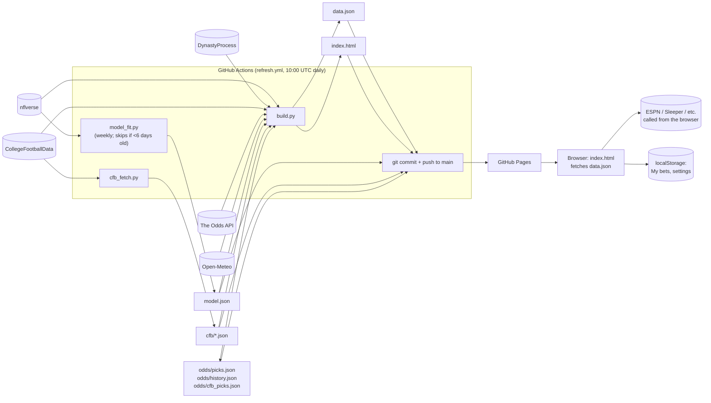
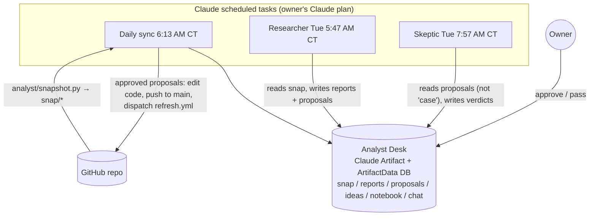

# 02 — Architecture and data flow

## The daily pipeline

Order of steps in `refresh.yml`:

1. `pip install pandas numpy` (unpinned)
2. `python model_fit.py || echo 'model fit failed…'`. A failure is swallowed.
3. `python cfb_fetch.py || echo 'college fetch failed'`. A failure is swallowed.
4. `python build.py` (with `CFBD_KEY`, `ODDS_API_KEY`, `ODDS_PLAN`, `ODDS_PROPS`)
5. `git add index.html data.json model.json cfb odds` → commit "Refresh data" → `git push`

Manual runs: `workflow_dispatch` takes a `props` input (`auto` | `all` | `off`).

## The agent loop (outside the repo)

Details are in [07-analyst-agent-layer.md](07-analyst-agent-layer.md).

## Where state lives

| State | Location | Written by | Notes |
|---|---|---|---|
| Rendered dataset | `data.json` | `build.py` | Rewritten in full every run |
| Pick ledger (NFL) | `odds/picks.json` | `build.py` | Ungraded future picks are dropped and re-added each run, so a pick "locks" at the last refresh before kickoff |
| Pick ledger (college) | `odds/cfb_picks.json` | `build.py` | Same pattern |
| Line history | `odds/history.json` | `build.py` | Up to 30 points per event; pruned to live events |
| Cached odds | `odds/lines.json`, `odds/props/<event>.json`, `odds/ncaaf.json` | `sources.py` | Protects the Odds API credit budget |
| College history | `cfb/games_YYYY.json`, `cfb/lines_YYYY.json` | `cfb_fetch.py` | Past seasons fetched once |
| Model | `model.json` | `model_fit.py` | Weekly refit |
| Big board | `boards/boards_2027.csv` | the owner, by hand | |
| User bets, settings | browser localStorage | `index.html` | Per device; never reaches the server |
| Analyst reports, proposals, notebook | Analyst Desk DB (Claude Artifact) | Claude workers | Outside the repo entirely |

Git is the database. That works at this scale, but it ties every state change to a commit on `main`.
The consequences are covered in [08-assessment.md](08-assessment.md).

## Environment variables

| Var | Read by | Purpose |
|---|---|---|
| `SEASON` | `sources.py` | Default 2026 |
| `CSV_PATH` | `sources.py` | Local season-stats CSV override |
| `DP_DIR` | `sources.py` | Local DynastyProcess files override |
| `CFBD_KEY` | `sources.py`, `cfb_fetch.py` | CollegeFootballData bearer token |
| `ODDS_API_KEY` | `sources.py` | The Odds API key |
| `ODDS_PLAN` | `sources.py` | `free` (default) or `paid`; controls the props schedule |
| `ODDS_PROPS` | `sources.py` | `auto` / `all` / `off` |
| `ODDS_BOOKS` | `sources.py` | Override the book list |
| `ODDS_OFFLINE` | `sources.py`, `build.py` | Use cached odds, spend no credits, write no ledgers, skip weather |
| `FORCE` | `model_fit.py` | Refit even if the model is fresh |
