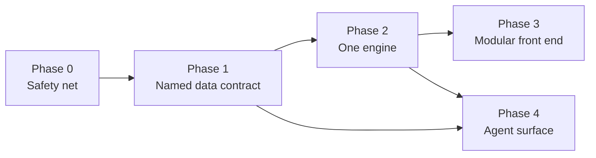

# 09 — Refactor roadmap

The goal is to set the repo up for **new modules** and **agentic access** without stopping feature work.
Each phase ships on its own and leaves the site working. Effort figures are rough, for focused work with Claude.



## Phase 0 — Safety net (1-2 days)

Do this first, because every later phase edits the logic that produces picks.

- **Golden-output test.** Freeze a fixture (cached nflverse CSVs + `odds/` + `model.json`), run `ODDS_OFFLINE=1 build.py`
  against it in CI, and assert on the pick ids, records and a few headline numbers. This becomes the parity check for
  every refactor that follows, replacing the Playwright step in `SYNC.md`.
- **Fail loudly.** Record each section's status in `META.health` (`ok` / `failed: <reason>`). Fail the workflow if a
  core section (stats, teams, odds when a key is present) is missing. Show a small banner on the page when a section is degraded.
- **CI hygiene:**
  - Add `requirements.txt` with pinned versions and run the workflow with it.
  - Add a `concurrency: refresh` group to `refresh.yml`.
  - Run the golden test on pull requests.
- **Quick fixes:**
  - `zoneinfo('America/Chicago')` instead of UTC-5.
  - Replace `%-I`.
  - Delete `G_FALLBACK` and fail when the schedule can't load.
  - Add `tdmax` to the page's fallback `RU`.
- **Proposed process change (owner's call):** the analyst sync opens a PR and enables auto-merge on green, instead of
  pushing to `main`.

## Phase 1 — Named data contract (2-4 days, incremental)

- Write `schema/data.schema.json`, starting from [03-data-contract.md](03-data-contract.md), and validate `data.json`
  against it in CI.
- **Non-breaking first step:** emit a column dictionary (`D.SCHEMA = {"P": ["name","team","games",…], …}`) and add
  named accessors in JS and Python, so new code reads `row.get('gsis_id')` instead of `row[8]`.
- Then convert blocks from positional arrays to objects one at a time, smallest first (`OLP`, `X`, `P`, then `DY`, `CF`),
  each behind the golden test. JSON size grows a bit; gzip on Pages absorbs most of it.
- Bump `META.schema` to 3 when done.

## Phase 2 — One engine, imported everywhere (3-5 days)

Create a Python package (e.g. `engine/`) and make `build.py` a thin orchestrator:

```
engine/
  odds.py         prob, dec, novig (Shin), fair odds, best price
  rules.py        RU thresholds + valS/ptier; the one source of truth
  projections.py  base recipe, matchup factor, pover, TD model (shared by build, model_fit, lab)
  picks.py        game sides, prop sides, pick list, pick ids
  parlays.py
  grading.py      grade_one, units, records
  team_model.py   NFL + college ridge ratings
  sections/       one builder per data.json block: def build(ctx) -> dict
build.py          load sources → run sections → validate → write
```

- **Remove the browser copy of the pick engine.** Have the build precompute picks **per book** (`ODD.PKB[book]`). The page
  only filters, so the "Best available / one book" picker keeps working with no JS pick logic.
- `snapshot.py` and `lab.py` import `engine` instead of copying it. The Desk `RULES` prompt is generated from `rules.py`.
- Unit-test `engine/` on the odds math and grading edge cases (pushes, voids, half-point crossings, parlay pushes).
- Keep the fantasy logic that genuinely depends on the user's league in the browser (`bestLineup`, trade finder,
  Sleeper/ESPN imports). Move its pure math into small JS modules.

## Phase 3 — Modular front end (3-5 days, can overlap Phase 2)

- Split `template.html` into native ES modules (`<script type="module">`; no bundler needed on Pages):
  `core/` (state, a namespaced storage wrapper, `html` escaping template), `ui/` (table, sort, gloss, colorize),
  `sections/*`, `glossary.json`.
- **Section registry:** each module exports `{id, label, parent, dataKeys, init, render}`. The nav bars, show/hide,
  the init order and per-section error boundaries are all generated from it. Adding a module then means one file plus one registry line.
- **Hash router** (`#bet/props?book=dk`) for deep links. Agents and shared links can then point at a view.
- **Shard `data.json`** by domain (`core`, `players`, `dynasty`, `college`, `odds`) and lazy-load each shard on first
  visit. That cuts first paint, and the shards become static API endpoints for Phase 4.
- Route every dynamic string through the escaping template. This closes the XSS findings.

## Phase 4 — Agent surface (2-4 days after Phases 1-2)

Three layers, cheapest first:

1. **Static read API.** The sharded, schema-validated JSON on GitHub Pages is already an API any agent can `fetch`.
   Document it in `docs/api.md` with the schema.
2. **MCP server** (`mcp/`, Python, stdio; run locally or by scheduled Claude tasks). It wraps `engine/` and the data with
   named tools, roughly the Desk Ask tab's 10 tools made portable:
   `get_week_games`, `get_picks(book?)`, `get_pick_log(filters)`, `get_player(name|id)`, `get_props(player|game)`,
   `explain_pick(id)`, `get_team(code)`, `backtest(recipe, seasons)`, `calibration(prop)`, `add_idea(text)`.
   The Desk and the scheduled workers then share one tool surface.
3. **Agent write path.**
   - Agents change code only through PRs, gated by the Phase 0 tests.
   - Proposal, decision and notebook records are mirrored into the repo (e.g. `decisions/YYYY-MM-DD-<slug>.md`) so model
     history is auditable without the Desk.
   - Add an `AGENTS.md`/`CLAUDE.md` at the repo root that points to this knowledgebase, the schema and the test commands.

## Later (when the app opens to other people)

- Move ledgers and user data out of git into a real store (SQLite on a small host, or a hosted DB), and keep data
  builds on a `data` branch or object storage so `main` history stays code-only.
- Accounts, server-side My bets, rate-limited ESPN/Sleeper proxying, and the ROADMAP's About / "not betting advice" page.

## Suggested order

| Order | Item | Why first |
|---|---|---|
| 1 | Phase 0 golden test + fail-loud + concurrency | Makes every later change safe and checkable |
| 2 | Phase 1 column dictionary + accessors | Cheap, non-breaking, and unblocks both modules and agents |
| 3 | Phase 2 `engine/` + per-book picks | Removes the highest-risk duplication |
| 4 | Phase 3 registry + router, then shards | Lowers the cost of each ROADMAP feature |
| 5 | Phase 4 MCP + PR-based agent writes | Builds on stable data and logic |

## Questions to settle with the owner before starting

1. Is the single-book view the only reason picks are recomputed in the browser? If so, per-book precompute replaces it.
2. Would the owner accept the analyst sync opening PRs (with auto-merge on green) instead of pushing to `main`?
3. Can the Desk's notebook and proposals be mirrored into the repo, so collaborators can see model history?
4. Which ROADMAP item comes next? The home screen, trade analyzer and playoff SOS all benefit from Phase 3's registry.
5. How public is "opened up to other people", and when? That decides how soon the storage and security work is needed.
